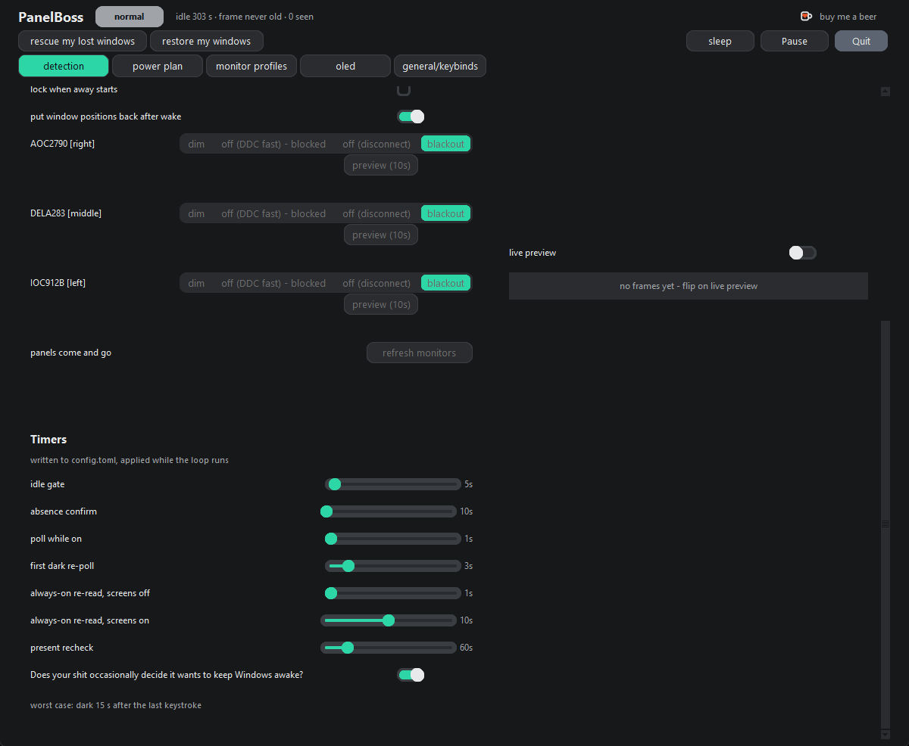
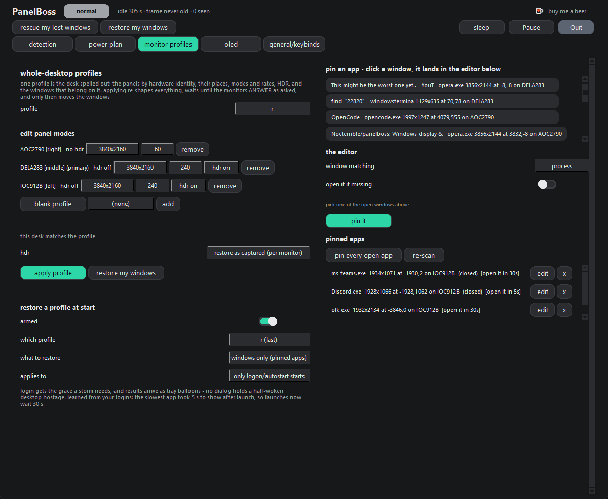
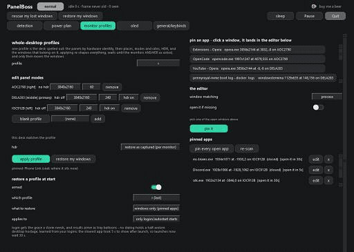
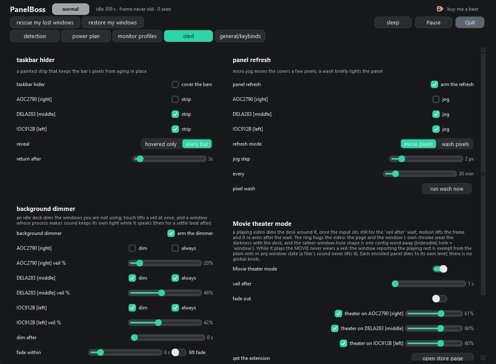
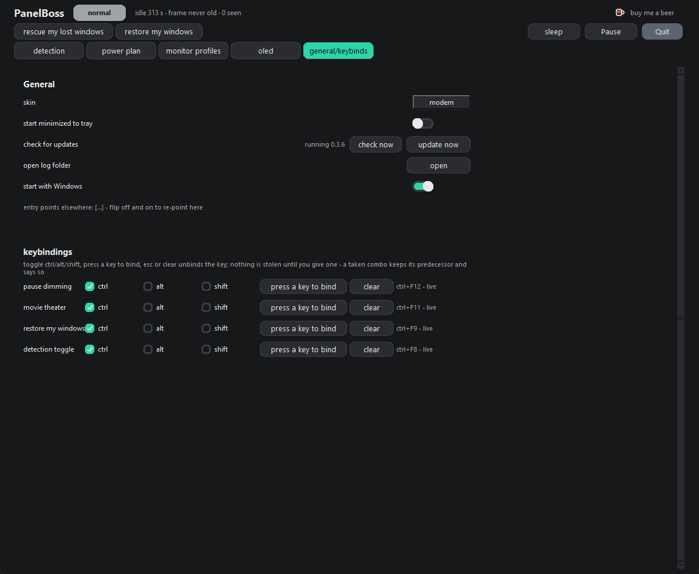

# PanelBoss

PanelBoss keeps a Windows desk running itself when nobody is at it, and gets
out of the way when somebody is. What it does, one line each:

- **Presence.** A local camera decides whether you are at the desk. The frames
  never leave the machine.
- **Screen control.** An unwatched panel dims, blacks out, or drops its signal,
  chosen per monitor, and everything comes back when you return.
- **OLED care.** The taskbar and the background darken while you are away, a
  periodic pixel wash spreads static wear, and fake input from macro pads and
  KVMs is ignored.
- **Movie theater.** With the free browser extension, darkness hugs the playing
  video: the page, the browser chrome, and the rest of the desk go dark while
  the film keeps its light.
- **Game rates.** A fullscreen game gets the refresh rate you set for that
  panel, VRR pin-max included.
- **Desk memory.** Window positions come back after any wake, and a whole desk
  setup - monitors, modes, pinned window seats - saves as a profile keyed to
  the hardware, restorable at logon.

It runs under your own Windows account and lives in the tray. There is no account
to create and no telemetry. Presence is judged from a local camera, and those
frames never leave the machine.

Nothing else in the app touches the network, with one exception: pressing Check
for updates asks GitHub which release is newest. Press it once, or never. The
optional browser extension is local too. The browser and the app talk over a pipe
on your own PC, with no server in the middle.

## Install

Download `PanelBoss-<version>-user.msi` from
https://github.com/Nocterrible/panelboss/releases and run it. The MSI is the
normal way in; the page always carries the newest build. Movie theater mode
also wants the optional Companion extension - free on the Chrome Web Store,
https://chromewebstore.google.com/detail/panelboss-companion/feolhiokchmpphlhllagimnilceldegk
- it works in Chrome, Edge, Opera, Brave, and the other Chromium browsers.
Every other feature runs with the MSI alone.

It is per-user: no admin and no UAC prompt at install, upgrade, or uninstall. One
thing does ask, a scheduled task, and Uninstall below explains it.

The MSI is not code-signed. The first time you run it, SmartScreen says "Windows
protected your PC", so choose More info, then Run anyway. That is a choice, not a
defect: a signing key is a renewing bill, and the sha256 of every build is on the
release page if you want to check it yourself.

On some Windows 11 installs, Smart App Control blocks an unsigned MSI outright
with no More info route, and there you have to turn Smart App Control off or use a
signed build.

The app lands in `%LOCALAPPDATA%\Programs\PanelBoss` with a Start Menu entry.
Starting with Windows is an opt-in on the General / Keybinds tab, never silent.

**From source (git):** clone https://github.com/Nocterrible/panelboss, make a
virtualenv on Python 3.10+, and install `requirements.txt`. `scripts\setup.ps1`
does both and downloads the detection model into `models\`; start with
`python run.py`. `--autostart` on the command line is how the app knows a logon
start.

Source and MSI share one settings folder, `%APPDATA%\PanelBoss`, with the logs in
its `logs` folder. That means you can run either kind and keep the same settings.
Only one copy runs at a time: a second launch wakes the running window and exits,
or shows a brief "already running" box if nothing answers.

To update an MSI install, use Update now on the General / Keybinds tab, or run the
newer MSI by hand. Either way your settings and logs are untouched. Before an
update touches anything, it copies `profiles.json` and `config.toml` to
`%LOCALAPPDATA%\PanelBoss\update` as `.bak` files, so a bad update still leaves
you a way back.

## Uninstall

Uninstall runs the app's own cleanup as your user. It puts back any display the
app left disconnected, removes its Run-key entry, takes down the companion's
browser door (the HKCU registration and its host.json pointer), and removes its
scheduled task.

That scheduled task is the one prompt you get. If the power assistant was
registered, uninstall asks once to remove it, the same single confirm that
registered it. Refusing is safe: the uninstall still finishes, and the orphaned
task does nothing.

Settings and logs under `%APPDATA%\PanelBoss` survive all of it.

## First run

Camera detection starts off, so no camera opens until you turn it on. Turning it
on offers a setup that opens each camera once and lets you label it, hide it, or
put it on duty. Four cameras can be on duty.

## The window

There are five tabs, one subject each. Above them sit the commands you can reach
at any time:
rescue my lost windows, restore my windows, sleep (pick the minutes), Pause, Quit.
Left-click the tray icon to open the window; right-click for the camera and mode
pickers, the wake policy, pause, snooze 10/30/60, start with Windows, and Quit.

### Detection

The switch at the top is consent. With it off, the tab grays out and the note says
cameras will not open until you turn it on.

Person (AI) mode runs an ONNX detector and gives you the device (auto, CPU, or
CUDA), the GPU id, confidence (0.10 to 0.90), and min hits, the positive frames in
a row before the screens wake (1 to 4). Motion (no AI) mode uses no model: it
compares frames, so it drives infrared and depth sensors exactly like a webcam.
Its controls are frame changes, pixel delta, and motion hold.

Motion hold is how long presence lingers after the last movement, because reading
a page is stillness, not absence. Raise it if the screens keep going dark while
you are just sitting there reading.

The away card sets what "away" means, one answer per monitor, and each row picks
its own dark. Dim keeps the panel powered and drops its brightness to the shared
level, 1 to 40 percent. Blackout paints an opaque cover that a click wakes. Off
(DDC fast) sends the panel's own power code, so it goes dark as if you had pressed
its button. Off (disconnect) retracts the signal at the adapter, and Windows will
not let the last active display be stranded.

A disconnected panel survives this app too, because the state lives in Windows'
own display store; Settings > Display, or just replugging the cable, is the way
back.

Off (DDC fast) starts disabled on NVIDIA-driver machines. Resumes from this off
have frozen some of them with bugcheck 0x133, the DPC watchdog, a family also seen
on the same driver with the app not running. It returns once a driver is confirmed
safe, and AMD and Intel desks get it on day one.

A config that already says off (DDC fast) is honored end to end. The block only
gates new picks, and you change a blocked pick by choosing another mode on that
row. The option is grayed out, never hidden, so you can see it and read why.

An unworded row follows the legacy [away] mode key before the default, and a row
you never touched defaults to off (disconnect). Lock when away starts ends the
session too, so the panels wake to the lock screen. Preview applies one row for 10
seconds and reverts; a second click cancels.

Some panels refuse DDC/CI writes, and a KVM often explains why. PanelBoss reports
it instead of hiding it. A write accepted but never proven reads (unverified) on
its row, and a refused write falls back to painted blackout, the row saying which.

A dimmed panel comes back at the end of an away spell with the brightness it had
when the dim started, not a fresh boot read. The ledger that remembers it starts
at boot, so even a fresh install has it.

The Timers card holds the seconds: idle gate (0-180, no camera while input is
recent), absence confirm (10-300), poll while on and first dark re-poll (1-15),
the always-on re-read gates (1-15 and 5-15), present recheck (10-300), re-off
grace (0-120), and leave-on grace (10-600). It prints the result underneath: dark
N seconds after the last keystroke.

The pump row on that card asks it in its own words: "Does your shit occasionally decide it wants to keep Windows awake?"

Devices like macro pads, KVMs, and jigglers keep telling Windows that someone just
typed. The pump makes PanelBoss trust only real movement, and every idle timer on
every tab reads it. With the pump off, the app uses Windows' own idle clock as-is.
It takes a relaunch to change, and a deaf pump falls back to the system clock by
itself. The switch ships on.

*The Detection tab, scrolled down to the Timers card. The pump row is the last
switch, with its question in full.*

The Camera card adds cameras from a picker. An on-duty camera leaves the menu and
gets a policy row. Labels ride the camera's hardware identity, so a replug cannot
lose a name. Rescan re-scans and re-tests, and a camera that serves no frame is
marked "(no image during diagnostic)".

Duty is set per screen state: boot per poll opens and closes the camera once per
poll, and always on holds the stream open. Each camera can override the global
answer with follow-global, poll, always on, or off. Four cameras is the limit.
Live preview shows the exact frame the detector judged, and hidden cameras get a
show button.

### Power plan

Two override rows, screen power off and sleep, each answering off, on, or while
present (camera). The power plan itself is not changed: its timers are held back
while the app watches and handed back when the app pauses, snoozes, or quits.

While present holds only while the camera's last verdict saw a person; absent or
no verdict hands the timer to the plan on the spot. The choice is grayed out,
never hidden, while detection is off. If the eye goes quiet mid-watch, one tray
notice says so: the camera stopped seeing, and presence-based behavior is paused
until it sees a person again.

The wake card picks re-off or leave-on for unexpected wakes. It can hold off while
a fullscreen app owns the display, wait for a resume after two unexpected wakes in
a row, and put window positions back after a wake. The powercfg assistant is
opt-in: one admin confirm registers a task that reveals which processes hold the
display awake. The card lists them, and while one holds, the camera stops
defending a screen it does not own.

Gaming is the right column, off by default. A fullscreen game gets the panel's
picked rate (auto, an explicit Hz, or VRR pin-max for G-SYNC you enabled
yourself); outside games the desktop rate is law, and keep means no rule. Drivers
that report HDR precisely get a desktop hdr on/off/keep pick.

Listed exes enter the moment they own a monitor. Anything else must hold sustained
3D load or use a controller API, and a grace timer keeps alt-tabbing from
flickering the panel. A power plan can swap in per game, and the previous one
returns after.

### Monitor profiles

One profile is the desk written down: which physical panels (by hardware
identity), their places, the primary, resolution and refresh per panel, the HDR
ask, and where every pinned window belongs.

The picker opens on the profile matching this desk's hardware identity, even when
a panel has not landed its wanted modes yet. Updates keep a backup of profiles and
config in the update folder described above; create new... copies what the desk is
doing now. A profile cannot fix a monitor that is not plugged in.

The mode editor offers each panel resolution and refresh from the driver's own
list, its live HDR state, and, where the driver answers precisely, an hdr
on/off/keep selector. The HDR ask per apply is restore as captured, ignore, or
force all capable panels on or off. On Windows 11 24H2 and newer, disagreements
are commanded and read back; on older Windows, restore as captured skips itself
rather than guess.

The desk gate refuses to apply onto panels the profile does not name, and try
anyway (best effort) appears only then. Applying waits until monitors answer,
moves windows, and rescues stragglers off-screen.

Pins reserve seats. A process-matched pin moves every window of that app;
process-plus-title is the one-window road, and open it if missing launches the
exe. A minimized window is present, not missing: it is restored into its seat, not
re-launched.

The patience behind open it (0 to 10 minutes, default 0) is a boot grace only. A
manual restore waits nothing before launching; the logon restore waits the stored
number, because the desktop is still settling and apps race their own startup.
After a manual launch, the app gets a fixed fifteen seconds to show its window,
and only past that does the did-not-turn-up dialog speak. A browse field points
the pin at launchers and shortcuts.

Restore-at-start re-applies a profile at launch: any profile or the last one for
this desk; whole desk, monitors only, or windows only; on logon starts, proved by
the Run entry's --autostart, or every start. Restore my windows moves pins only
and asks the drivers nothing.

*The Monitor profiles tab. The picker and the mode editor are on the left; the
pin editor and the list of pinned apps are on the right.*

### OLED

The taskbar hider paints a strip over the bar's fixed pixel row, opted in per
monitor. It steps aside for the cursor and covers again after 1 to 30 seconds.
Reveal is per bar or all bars, and the card flags a clash with Windows' own
auto-hide. The strip is an ordinary window, so it dies with the app and changes
nothing while the app is closed.

One catch: the strip covers the bar without telling apps that asked Windows for
the work area, so a fullscreen window can slip behind it. The card says so too.

Panel refresh walks the app's strips around a zero-drift ring every 5 to 180
minutes, 1 to 8 pixels a step. The wash is a request, never a schedule: run wash
now lights opted-in panels white for ten seconds, once.

The dimmer card arms background dimming, opted in per monitor. Once the dim after
wait passes (0 to 60 seconds of stillness), every background window wears a veil
at the veil level (10 to 90 percent), with per-panel overrides. The dim layer
covers the whole background, so the bare desktop dims with its panel's windows at
that panel's own level, and so does the taskbar there whenever the hider is not
covering it.

The foreground and anything making sound keep their light; a window the microphone
just heard stays bright for four seconds. Menus, tooltips, and transient popups
never dim. Administrator windows stay bright unless PanelBoss runs elevated, which
is not recommended.

Always dims a panel without the idle wait, and that row yields to the foreground,
never to motion. The window playing your video never wears the dim layer,
backgrounded included; pause the video and the dim layer comes back. Fade within
(0 to 60 seconds) shapes the return, and lift fade decides whether a plain veil
fades or drops the instant you touch the desk. Apps are excluded by exe name. The
pause hotkey lives on the General / Keybinds tab, not here.

Movie theater mode is what the Companion is for, and you consent to it separately.
Once a video plays and input sits still for the veil-after wait (1 to 30 seconds),
a ring of darkness hugs the video itself. The hole is the video's own rectangle,
so the page and the browser's chrome wear the darkness with the desk, and the
window playing the video never dims.

*Movie theater mode on the OLED tab. In-app capture for now; a real clip replaces
this file.*

Motion lifts the ring, which re-arms after the same wait; a film's sound never
lifts it. Pause the video and the ring lifts too, and that window becomes an
ordinary background window again for the dimmer above.

When a video covers its panel, that panel has no room to ring, so the darkness
lands on the other enrolled panels only. Prefer the calmer window-hole shape, the
whole window bright inside the ring? It is one config word away: [videodim] hole = "window".

Theater levels are per monitor on the card: each enrolled panel's row dims to its
own level (10 to 90 percent, the frame's own darkness, independent of the
dimmer's). There is no global knob, and a file without a panel's level uses the
silent default.

The per-monitor boxes enroll panels. An enrolled panel with no video wears a
full-field veil while the conjunction holds; an unenrolled one dims like any idle
desk. Fade out is the opt-in, the lift instant by default. The card also carries
open store page, install the helper, the doorway file, the host's capability line,
and measure now for a one-shot geometry check.

*The OLED tab. The taskbar hider and panel refresh are on top, the background
dimmer is bottom left, and Movie theater mode is bottom right.*

### General / Keybinds

Skin picks the palette; layout and behavior are identical. Start minimized to tray
applies next launch, and closing the window always hides it to the tray anyway.

Start with Windows writes the per-user Run key, the entry Task Manager's Startup
tab lists, and reads the registry back to be sure; if the entry points at a
different copy, the note says so and a flip re-points it.

Check for updates asks GitHub what the latest release is; Update now applies it. A
source install pulls and refreshes dependencies. An MSI install fetches the newer
MSI, closes the app, and hands the switch to Windows Installer. Open log folder
opens the folder that holds the app's decision log.

The keybindings card binds four global hotkeys: pause dimming, movie theater mode,
restore my windows, and the detection consent switch. Each row carries ctrl, alt,
and shift toggles beside its bind button. Tick the modifiers you mean, click bind,
press the key; the binding is the toggles plus that key, and modifiers physically
held during the press change nothing.

That last part is deliberate: a thread's message queue can report Alt or Ctrl as
down long after your fingers let go, so the card reads only the key. Esc clears
the key and the toggles stay, since they are settings. A binding stored by an
older build may show a combo other than the one you gave, so esc and rebind once.

A bare letter will not bind, since letters are for typing; a plain function or
media key will. A key is unbound until you give it one, and a combo that is
already taken keeps its predecessor and says so. A press runs the same verb as the
matching switch or button, so pause toggles the dimmer the way the card's checkbox
does, theater flips the companion switch, restore applies the captured windows
layout, and detection flips the big consent switch on the Detection tab.

*The General / Keybinds tab. The app reports its own version on the update row,
and the four hotkeys are bound with modifier ticks, not key chords.*

## PanelBoss Companion

A browser extension that reports the playing video's rectangle to the app. That is
all it does. It is on the Chrome Web Store as PanelBoss Companion, version 0.4.5,
approved:
https://chromewebstore.google.com/detail/panelboss-companion/feolhiokchmpphlhllagimnilceldegk

The app installs the Companion's local native-message host. The "install the
helper" button on the movie theater card registers it under your user account with
no admin. The MSI ships the host already built, with the host folder riding the
bundle; from source, the same button builds it first with PyInstaller in the venv.
The manual route is `extension\host\install_host.ps1`, and `extension\README.md`
documents the API and the rest.

The toolbar button opens a small readout of the current tab: the video's box in
pixels, the device pixel ratio, the viewport, the scroll offset, the window's own
report of where it sits, and whether the video is playing or paused. There is also
a test button that asks the app to frame the video right now.

The automatic lane only runs on the sites listed in the extension's manifest, and
it is quiet everywhere else. It measures the top frame of the page, so a player
inside an iframe is invisible to it.

The Companion is optional; movie theater mode is the only feature that needs it.

## Hello IR

Hello IR puts the Windows Hello infrared sensor, the camera that unlocks the
machine, on presence duty. Hello cameras hide from normal enumeration, so the app
reads them through `whircam`, an optional MIT package. Pick "hello IR camera
(optional - pick to install whircam)" in the Detection tab's camera menu and the
sensor is on duty.

The installed app carries the bridge inside the MSI; a source tree installs it
with the same prompt, which runs the updater's `scripts\setup.ps1 -Optional`, a
pip of the one-line `requirements-optional.txt` (that pip path is the source
tree's, never the installed app's). The sensor keeps serving frames while Windows
Hello stays armed, and its seat can be labelled and removed like any other camera.

## License

MIT. The full engineering log, every bug found and fixed with its date, is
`AUDIT-PUNCHLIST.md`. It is messy and honest, and that is the point.
